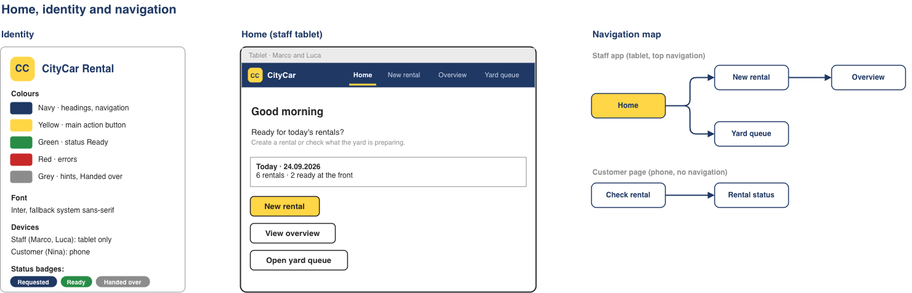
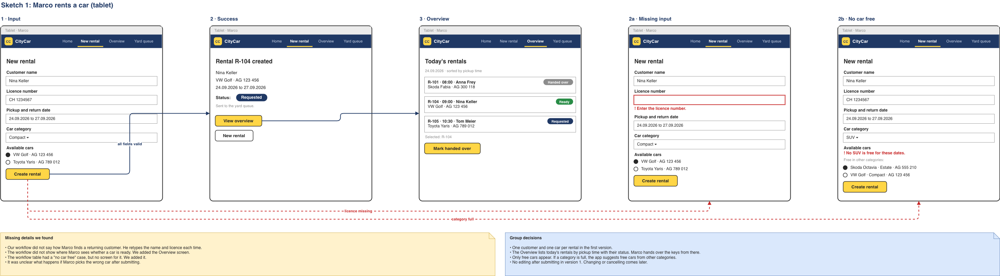
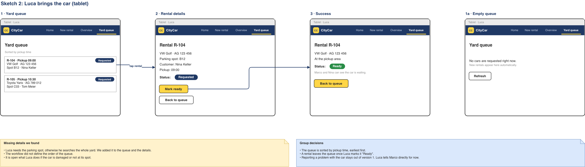
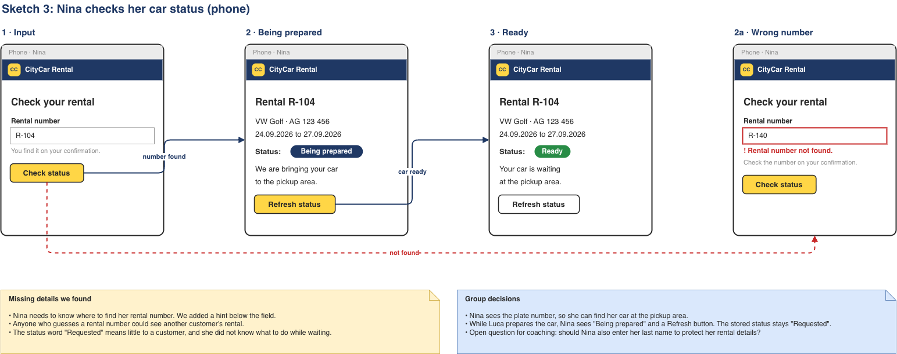

# CityCar Rental — car-rental-web-app

**Current stage:** Milestone 3 ready for the coaching on 16 November: Jinja2 workflow screens for all three workflows (Marco, Luca, Nina) served by FastAPI, backed by SQLite. API contract unchanged; 63 tests (36 API, 26 workflow screens, 1 concurrency). This README is the living project document; milestones are added to it rather than to separate files.

## Project overview

CityCar Rental is a small car rental branch. Rentals are agreed at the service desk, but the cars stand in a yard behind the building, and a second employee has to fetch them. Today that handover runs on shouting across the yard and paper notes, so cars are fetched in the wrong order, the desk cannot tell a waiting customer whether their car is ready, and customers queue at the desk to ask.

This web application replaces those notes with one shared status per rental. The service desk creates a rental and picks a free car; the request appears immediately in the yard worker's queue with the parking spot; when the car is at the pickup area the yard worker marks it ready, and both the desk and the customer see that at once. Customers check their own rental on their phone with the rental number instead of asking at the desk.

**Intended users:** service-desk staff and yard staff (staff app on a tablet), and rental customers (status page on a phone).

**Initial scope:** the three workflows below — create a rental, prepare the car, check the status. Payment, insurance options, online self-booking, returns, cleaning logs and damage reports are deliberately out of scope for the first version.

### Team and responsibilities

| Member | Milestone 1 | Milestone 2 | Milestone 3 |
|---|---|---|---|
| Fabian | Repository setup, README, data model, workflows, sketches, clickable prototype, example JSON | Code review | Concurrency fix (`BEGIN IMMEDIATE`), workflow screen test suite, error-handling corrections |
| Samson | Workflow analysis, review of sketches and example data | FastAPI project skeleton, Pydantic models, CRUD API for cars/customers/rentals, service layer with business rules, 36 API tests, SQLite migration via SQLAlchemy 2.0, README documentation | Jinja2 workflow screens for all three workflows, POST/redirect/GET flow, form error handling, README updates |

The project is a two-person team, so the template's four suggested roles are shared between us rather than split further. Both of us reviewed every workflow, sketch and decision together — the table records who drove each part, not who understands it.

## 1. Analysis

### Scenario, users and goals

- **Situation or problem:** the service desk and the yard do not share a live view of a rental. Requests are passed on informally, so cars are prepared in the wrong order, and nobody at the desk can answer "is my car ready?" without walking into the yard.
- **Intended users:** *Marco*, service desk — needs to record a rental quickly and see which cars are ready to hand over. *Luca*, yard — needs to know which car to fetch next and where it is parked. *Nina*, customer — wants to know when her car is ready without queuing at the desk.
- **Proposed benefit:** one status per rental, visible to all three roles at the same time. Fewer wrong cars fetched, no repeated questions at the desk, and a customer who can wait comfortably instead of standing in line.
- **Initial scope:** one rental holds one customer and one car. The first workflow to explore is creating a rental, because the other two depend on the data it produces.

### User stories and first workflow

- As a **service-desk employee**, I want to create a rental with a car that is actually free, so that the yard receives a complete and correct request.
- As a **yard worker**, I want to see which cars are requested and where they are parked, so that I fetch the right car next without searching the yard.
- As a **customer**, I want to check whether my car is ready, so that I do not have to ask at the desk.

**Out of scope for now:** changing or cancelling a rental after submitting, returns and mileage, payment and insurance, damage reporting, and any customer self-service booking.

#### Workflow 1 — Marco creates a rental (the first workflow)

| Step | User / role | Action | Information needed | Expected result or feedback |
|---|---|---|---|---|
| 1 | Marco, service desk | Enter the customer's name and licence number | Customer name, licence number | Inputs are kept ready; nothing is saved yet |
| 2 | Marco | Choose pickup date, return date and car category | Pickup date, return date, category | Only cars free in that category for that period are listed |
| 3 | Marco | Select a car and submit | Selected car | All fields filled, return date after pickup date, car still free |
| 4 · success | Marco | Read the confirmation | — | Rental number and plate are shown; the rental enters the yard queue as *Requested* |
| 3a · alternative | Marco | Submit with the licence number missing | — | "Enter the licence number" next to the field; other inputs kept; no rental created |
| 2a · alternative | Marco | No car is free in the chosen category | — | The app says so and lists free cars from other categories |

#### Workflow 2 — Luca brings the car

| Step | User / role | Action | Information needed | Expected result or feedback |
|---|---|---|---|---|
| 1 | Luca, yard | Open the yard queue | — | Requested rentals, earliest pickup first, with plate, parking spot and customer name |
| 2 | Luca | Choose the next rental | Rental number | Car details and where the car is parked |
| 3 · success | Luca | Bring the car to the front and mark it *Ready* | — | Status updates so Marco and Nina see the car is waiting; the rental leaves the queue |
| 1a · alternative | Luca | Open an empty queue | — | "No cars are requested right now" |

#### Workflow 3 — Nina checks her status

| Step | User / role | Action | Information needed | Expected result or feedback |
|---|---|---|---|---|
| 1 | Nina, customer | Open the status page and enter her rental number | Rental number | Hint below the field explains where to find the number |
| 2 | Nina | Submit the rental number | — | The number is checked against existing rentals |
| 3 · success | Nina | Read the status | — | Car, plate and status; when *Ready*, told to go to the pickup area |
| 2a · alternative | Nina | Submit a wrong rental number | — | "Rental number not found, check your confirmation"; input kept for correction |

**Exception worth discussing:** the "no car free in this category" case. We show free cars from other categories instead of an empty list, but it is open whether Marco may simply book across categories at the same price, or whether that needs a supervisor's approval. See the open questions in section 3.

## 2. Design

### Screens and navigation

**Live project site:** <https://fab132.github.io/car-rental-web-app/> — the clickable prototype and the sketches, served from the `docs/` folder of this repository.

The sketches cover the shared layout plus one page per workflow, each with its alternative states. Click an image to open it full size — the pages are wide, because every state of a workflow is drawn side by side.

**Shared identity and navigation**

[](docs/sketches/sketch-0-home-and-identity.png)

Identity, colour roles (navy for navigation, yellow for the main action, green for *Ready*, red for errors, grey for hints and *Handed over*), the three status badges, the staff Home screen and the navigation map.

**Workflow 1 — Marco rents a car (tablet)**

[](docs/sketches/sketch-1-marco-rent-a-car.png)

States drawn: *1 Input*, *2 Success*, *3 Overview*, and the two alternatives *2a Missing input* and *2b No car free*. The red arrows show which input leads to which alternative.

**Workflow 2 — Luca brings the car (tablet)**

[](docs/sketches/sketch-2-luca-bring-the-car.png)

States drawn: *1 Yard queue*, *2 Rental details*, *3 Success*, and the alternative *1a Empty queue*.

**Workflow 3 — Nina checks her status (phone)**

[](docs/sketches/sketch-3-nina-check-status.png)

States drawn: *1 Input*, *2 Being prepared*, *3 Ready*, and the alternative *2a Wrong number*.

Each sketch page carries two notes in its lower half — *Missing details we found* and *Group decisions* — which are the source of the decisions table in section 3.

**Sources and earlier iteration.** The editable originals are [`docs/sketches/car-rental-sketches.drawio`](docs/sketches/car-rental-sketches.drawio). Our first iteration is kept alongside them in [`docs/sketches/first-version/`](docs/sketches/first-version/) with its source file, so the change is visible: it had no shared identity page and no Overview screen, and both were added once we noticed Marco had nowhere to see which cars were ready.

**Clickable prototype (exercise 3).** **[Open the prototype](https://fab132.github.io/car-rental-web-app/prototype/)** — 16 static screens plus a start page, built with Bootstrap Studio and published with GitHub Pages, so no download is needed. The source is in [`docs/prototype/`](docs/prototype/). Buttons lead to the next screen; nothing is saved. Follow the suggested journey: Marco creates R-104 → Luca marks the car ready → Nina checks her phone → Marco marks it handed over.

**Navigation.** Staff work on a tablet with four top-level entries: Home, New rental, Overview, Yard queue. The customer page is a phone screen with no navigation at all — Nina only ever sees the check form and her own status, reached from a link on her confirmation.

**Main inputs, actions and feedback.** The staff app has exactly three actions that change data: *Create rental*, *Mark ready*, *Mark handed over*. Each one leads to a confirmation screen that restates what happened and names the next person in the chain ("Sent to the yard queue. Luca brings the car to the front."), because the three roles never see each other's screens. Errors appear next to the field that caused them and keep the other inputs. Status is shown as a coloured badge throughout — grey *Requested*, green *Ready*, grey *Handed over* — so the same rental reads the same way on every screen.

### Domain concepts and example data

Three things: **cars**, **customers** and **rentals**. A rental references one car and one customer.

- [`data/examples/cars.json`](data/examples/cars.json) — 5 cars
- [`data/examples/customers.json`](data/examples/customers.json) — 4 customers
- [`data/examples/rentals.json`](data/examples/rentals.json) — 4 rentals

All values are fictional. The files are consistent with each other and with the prototype screens: `rentals.json` references `car_id` from `cars.json` and `customer_id` from `customers.json`.

The example data is a snapshot of the Overview screen on 24 September, after Luca has marked R-104 ready: R-101 is handed over, R-104 is ready and R-105 is still requested. The prototype journey starts one step earlier, when Marco creates R-104 and its status is still `requested`. R-102 is not part of the sample, so the rental numbers are not continuous.

**Important fields and value types**

| Object | Field | Type | Note |
|---|---|---|---|
| car | `car_id` | integer | Internal identifier, never shown to users |
| car | `plate` | string | What staff and customers actually recognise, e.g. `"AG 123 456"` |
| car | `category` | string, one of `compact` / `suv` / `estate` | Marco filters by this |
| car | `parking_spot` | string | Where the car stands in the yard, e.g. `"B12"`; Luca needs it |
| customer | `licence_number` | string | Required; kept as text because of country prefixes like `"CH 1234567"` |
| rental | `rental_number` | string | Human-readable, e.g. `"R-104"`; spoken aloud and typed by the customer |
| rental | `pickup_date`, `return_date` | string, ISO 8601 date | Stored as `2026-09-24`, shown as `24.09.2026` |
| rental | `pickup_time` | string, `HH:MM` | Sorts the yard queue |
| rental | `status` | string, one of `requested` / `ready` / `handed_over` | The one value all three roles share |

**Marked uncertainties**

- Cars deliberately have **no `available` flag**. Availability is derived from rentals whose period overlaps the requested one — otherwise two sources could disagree. In the example data, `R-103` holds the only SUV from 23 to 28 September, which is exactly why Marco's "No SUV is free for these dates" screen is correct for a 24–27 September request.
- `pickup_date` and `pickup_time` are separate fields. One combined timestamp may be cleaner; we kept them apart because the sketches show a date picker and a queue sorted by time of day.
- `parking_spot` sits on the car, not on the rental. Once Luca moves the car to the pickup area the stored spot is stale. Whether the pickup area is just another spot value is open.
- `rental_number` is currently the only identifier for a rental. Whether it also needs an internal numeric id is open.
- The customer sees **"Being prepared"** while the stored status is still `requested`. The display label and the stored value are intentionally not the same, because "Requested" means little to a customer.

### Business rules and possible operations

**Rules**

1. Customer name and licence number are required; without them no rental is created.
2. The return date must be after the pickup date.
3. Only cars free for the whole period may be selected. If the chosen category has none free, free cars from other categories are offered instead of an empty list.
4. A new rental always starts as `requested` and appears in the yard queue.
5. A rental leaves the yard queue when it is marked `ready`.
6. Only a rental with status `ready` can be marked `handed_over`.
7. One customer and one car per rental in the first version; no editing or cancelling after submitting.
8. An existing licence number can only be booked under the name stored for it, ignoring capitals and extra spaces; otherwise no rental is created.

**Rule and exception in plain language.** A car may only be rented to one customer at a time, so a car whose rental overlaps the requested dates is not offered. The exception is the category: when nothing in the requested category is free, the app does not refuse the rental — it shows what *is* free elsewhere and lets Marco decide. In the implementation the rule lives in the service layer (`RentalService._check_car_free` in [`app/services.py`](app/services.py)); see "Trace one API operation and one interaction" below.

**Proposed operations** (draft intentions, not implemented endpoints)

| User goal | Proposed action | Example input | Expected output | Open question |
|---|---|---|---|---|
| See which cars Marco may pick | Read the free cars for a period and category | `category=compact`, `2026-09-24` to `2026-09-27` | List of free cars with plate and category | Should a full category return other categories, or should the caller ask again? |
| Create a rental | Create a rental | `{"customer_name": "Nina Keller", "licence_number": "CH 1234567", "car_id": 1, "pickup_date": "2026-09-24", "return_date": "2026-09-27", "pickup_time": "09:00"}` | Rental number, plate and status `requested` | Should an existing customer be reused instead of created again? |
| Fetch the next car | Read all rentals with status `requested`, sorted by pickup time | — | Rental number, plate, parking spot, customer name | Only today's, or all future ones? |
| See where one car is parked | Read one rental | `R-104` | Car, parking spot, customer, pickup time, status | — |
| Report the car as ready | Change a rental's status to `ready` | `R-104` | Updated status, visible to all three roles | What if Luca marks the wrong rental ready? |
| See today's rentals at the desk | Read today's rentals sorted by pickup time | `2026-09-24` | Rental number, time, customer, car, status | — |
| Hand over the keys | Change a rental's status to `handed_over` | `R-104` | Updated status | Reject when the rental is not yet `ready`? |
| Let the customer check her rental | Read the public status of one rental | `R-104` | Car, plate, dates and a customer-friendly status | Is the rental number alone enough to identify her? |

This table records the intended behaviour from the design stage; the implemented endpoints are listed under "API contract and architecture" below.

### Inspiration from existing apps or APIs — optional

Parcel-tracking pages (for example Swiss Post) show one shipment reduced to a single status plus a short sentence on what happens next, with no login. Nina's status page copies that idea: one number in, one status and one instruction out. What we would improve is honesty about time — a tracking page often shows a stale status without saying when it was last updated, so we added an explicit *Refresh status* button rather than implying the page is live.

### Current workflow and progress

Following the coaching feedback, the first implementation step was an admin API with full CRUD for the three domain objects, first stored in JSON files and since migrated to SQLite (see the design decisions below). The workflow screens (Milestone 3) call the same service layer.

#### Current workflow and backend progress

- **User goal supported:** the API holds the data behind all three workflows: Marco creates a rental, Luca works the yard queue and marks it ready, Nina reads its status. The sample data is in [`data/examples/`](data/examples/).
- **Working:** all 16 endpoints listed below, implemented and covered by the 36 API tests.
- **Partly implemented:** `POST /rentals` only accepts an existing `customer_id`. Creating a customer together with a rental exists in `RentalService.book`, which only the New rental screen uses.
- **Still planned:** login and access checks; every endpoint is open for now.
- **Changed from the design draft or after the first coaching:** an admin API with full CRUD came first, as agreed at the first coaching. Storage moved from JSON files to SQLite. A `ready -> requested` status change was added so a wrong *Ready* can be undone. The proposed customer fields on a rental became a `customer_id` reference.

#### Current workflow and frontend choice

**User and goal.** The connected journey starts with Marco at the service desk, who creates a rental for a customer with a car that is actually free ([sketch](docs/sketches/sketch-1-marco-rent-a-car.png), current screen at `/new-rental`). Luca's queue and Nina's status page continue the same rental.

**Why this approach fits.** Every step is a form or a page change that ends in saved data, and nothing needs to update without a page load, so server-rendered pages cover the journey without custom JavaScript. The screens and the API run as one application and share the same rules.

**Frontend approach.** The screens are server-rendered Jinja2 templates served by the same FastAPI app ([`app/routers/views.py`](app/routers/views.py), [`app/templates/`](app/templates/)), styled with Bootstrap and the CityCar CSS from the prototype. The assessment permits server-rendered templates when the approach is documented and the API covers at least one core entity; here the API covers all three. The view routes call the same service classes as the API routes, so every business rule is enforced in one place. They are excluded from the OpenAPI schema, which documents only the API.

| Screen | User | Request | Service call | Stored data |
|---|---|---|---|---|
| New rental (`/new-rental`) | Marco | `POST /new-rental` form: search, then create | `RentalService.available`, then `RentalService.book` | Reuses the customer with the same licence or inserts one, then inserts a `requested` rental, in one transaction |
| Yard queue (`/queue`, `/queue/{n}`) | Luca | `POST /queue/{n}/ready` | `RentalService.update` | Rental status `requested -> ready` |
| Overview (`/overview`) | Marco | `POST /overview/{n}/handover` | `RentalService.update` | Rental status `ready -> handed_over` |
| Status (`/status/{n}`) | Nina | `GET /status/{n}` | `RentalService.get` | Read only |

Form posts answer with a `303` redirect to the updated page (post/redirect/get), so a browser refresh does not repeat the action. When a service rejects an action (409 or 404 in the API), the screen shows the message as a banner or form error instead of the API's JSON body; invalid form input is shown next to the form instead of a 422.

**Tools used.** The running application is custom code: FastAPI routes, Jinja2 templates, the service layer and SQLAlchemy with SQLite. It uses no low-code or no-code platform. The templates load the Bootstrap 5 CSS toolkit from a CDN and our own `app/static/css/styles.css`, and contain no custom JavaScript. Bootstrap Studio, a visual editor, was used only for the clickable prototype in `docs/prototype/`. The browser sends ordinary HTML forms to the FastAPI view routes, which call the service classes directly in the same process and return finished HTML, so template routes and API routes share one set of business rules and one database.

**What changed from the sketches or after the backend coaching**

- Storage moved from JSON files to SQLite after the backend coaching, without changing the API contract.
- *Mark ready* and *Hand over* show a short note on the updated page instead of the separate confirmation screens in the sketches, and the note does not name the next person. *Create rental* keeps its full confirmation page.
- The Overview lists all rentals, earliest pickup first, rather than only today's.
- A missing required field is caught by the browser's own message rather than the sketched "Enter the licence number".
- Backend changes during integration: `RentalService.book` creates or reuses the customer and creates the rental in one transaction, and `BEGIN IMMEDIATE` keeps simultaneous bookings from getting the same rental number.

**What is connected, simulated, incomplete or planned**

| State | Parts |
|---|---|
| Connected | Create rental, mark ready and hand over save to SQLite; the status page reads the saved rental |
| Simulated | Nothing in the running application. The clickable prototype in [`docs/prototype/`](docs/prototype/) remains a design artefact and saves nothing |
| Incomplete | No page links to Nina's status page, so she has to open `/status` directly, although the design reaches it from her confirmation. Marco has no customer search. Undoing a wrong *Ready* (`ready -> requested`) is only possible through the API |
| Planned | Login and access checks, after the security class |

### Trace one API operation and one interaction

#### API operation: create a rental

**API request → input validation → business rule → storage → response**, for creating a rental:

| Part | What happens in our project | Relevant code or data |
|---|---|---|
| API | `POST /rentals` with `{"customer_id": 1, "car_id": 2, "pickup_date": "2026-10-20", "return_date": "2026-10-23", "pickup_time": "09:00"}` | `create_rental` in [`app/routers/rentals.py`](app/routers/rentals.py) |
| Input validation | Field types are checked, unknown fields are rejected and the return date must be after pickup. A failure returns `422` and the service is not called | `RentalIn` in [`app/models.py`](app/models.py) |
| Business logic | The customer and car must exist, otherwise `404`. The car must be free for the whole period (rule 3), otherwise `409`. A new rental always starts as `requested` (rule 4) | `RentalService.create`, `_check_references` and `_check_car_free` in [`app/services.py`](app/services.py) |
| Storage | The next rental number is assigned and one row is inserted into SQLite. The session commits at the end of a successful request and rolls back on an error | `RentalRepository.add` in [`app/repository.py`](app/repository.py), `get_session` in [`app/dependencies.py`](app/dependencies.py), `data/carrental.db` |
| Response | `201` with the stored rental, including `"rental_number": "R-106"` on a freshly seeded database and `"status": "requested"` | `Rental` in [`app/models.py`](app/models.py) |

Each part has one responsibility: routers handle HTTP, models check the shape of the input, services apply the rules and repositories talk to the database. They run in one application. Only the objects used during a single request are held in memory; cars, customers and rentals remain in `data/carrental.db` after a restart.

#### Interface interaction: Marco creates a rental

**User action → interface → request → business rule → storage → response → visible result**, for Marco creating a rental. The HTML is produced on the server by Jinja2. The interface makes no HTTP call to the JSON API: the view route calls the same service class as the API route, in the same process.

| Step | What happens in our project | Relevant code or data |
|---|---|---|
| User action | Marco enters `Lena Graf`, licence `CH 9988776`, 16 to 18 November and Compact, chooses the VW Golf and presses *Create rental* | [`app/templates/new_rental.html`](app/templates/new_rental.html) |
| Request | The browser sends the form as `POST /new-rental` with `car_id=1` and `step=create` | `new_rental_post` in [`app/routers/views.py`](app/routers/views.py) |
| Processing and storage | The return date must be after pickup and `BookingIn` validates the fields. `RentalService.book` checks that the car is free (rule 3) and that the name matches an existing licence (rule 8), reuses or inserts the customer and inserts a `requested` rental (rule 4), in one transaction in `data/carrental.db` | `RentalService.book` in [`app/services.py`](app/services.py), [`app/repository.py`](app/repository.py) |
| Result | The server answers `303` to `/new-rental/done/R-106`, and the browser loads a page built from the stored rental: "R-106 created for Lena Graf" | [`app/templates/rental_created.html`](app/templates/rental_created.html) |
| Error case | If the car has been taken in the meantime, `book` raises `ConflictError`. The route renders the form again with the message and the cars still free, and nothing is saved | `new_rental_post` in [`app/routers/views.py`](app/routers/views.py) |

### Run the current version

These are the only setup instructions; the screens and the API run together in one process. Dependencies are listed in [`requirements.txt`](requirements.txt). Checked with Python 3.13.

Run all commands from the repository root (`car-rental-web-app/`):

```bash
python3 -m venv .venv
source .venv/bin/activate         # Windows: .venv\Scripts\activate
pip install -r requirements.txt
python scripts/seed.py            # load data/examples/ into data/carrental.db (safe to re-run)
uvicorn app.main:app --reload     # keep this running
```

| What | Where |
|---|---|
| Staff screens (browser entry point) | `http://127.0.0.1:8000` |
| Customer status page | `http://127.0.0.1:8000/status` |
| API documentation (Swagger UI) | `http://127.0.0.1:8000/docs` |
| Tests, in a second terminal with the environment activated | `pytest` (63 tests) |

In Codespaces, run the same commands and open port 8000 from the **Ports** tab, adding `/docs` for the API. The pages load Bootstrap and the Inter font from the internet, so without a connection they work but lose most of their styling.

**Sample data.** The app stores its data in the SQLite file `data/carrental.db`, created empty on first start; `scripts/seed.py` fills it with the fictional example data, so the JSON files in the repository never change. Without the seed step the app starts with no cars, customers or rentals. To reset, delete `data/carrental.db` and run the seed script again. Set `CARRENTAL_DB_URL` to use another database file. Tests use a fresh in-memory database and never touch `data/carrental.db`.

**Check a saved result.** Read it back with `GET /rentals/{rental_number}` in `/docs`, or open `data/carrental.db` with a SQLite viewer. No credentials are needed or stored.

### Record what you checked

#### API

**Demo steps (API)**

Open `http://127.0.0.1:8000/docs` and use the Swagger UI to walk through the following cases. The same journey through the screens is under "Screens" below.

1. **Create a rental — 201 success.** `POST /rentals` → Try it out → paste the body below → Execute. Expect `201` with a new rental number.
```json
{
  "customer_id": 1,
  "car_id": 2,
  "pickup_date": "2026-10-20",
  "return_date": "2026-10-23",
  "pickup_time": "09:00"
}
```

2. **Duplicate booking — 409 conflict.** Same endpoint, same body → Execute again. Expect `409` because car 2 is already booked for that period.

3. **Yard queue — 200.** `GET /rentals` → Try it out → set `status` to `requested` → Execute. Expect only rentals with status `requested`, sorted by pickup time — this is Luca's yard queue.

4. **Free cars lookup — 200.** `GET /cars/available` → Try it out → `pickup_date: 2026-10-20`, `return_date: 2026-10-23` → Execute. Expect all cars except car 2, which is booked for that period.

5. **Invalid dates — 422.** Same endpoint → swap the dates (`pickup_date: 2026-10-23`, `return_date: 2026-10-20`) → Execute. Expect `422` because return is before pickup.

6. **Not found — 404.** `GET /rentals/{rental_number}` → Try it out → `rental_number: R-999` → Execute. Expect `404`.

7. **Run tests.** In the terminal: `pytest` — all 63 tests should pass.

Checked on 9 November 2026 on a freshly seeded database, by sending the demo requests with `curl` and reading the stored rentals back through the API. All 63 tests passed the same day.

| Case | Request or input | Expected result | Observed result / remaining issue |
|---|---|---|---|
| Success | Demo step 1: `POST /rentals` | `201`, new rental saved as `requested` | `201` with `R-106`; `GET /rentals/R-106` returned the same rental; stored rentals went from 4 to 5 |
| Rejected operation | Demo step 2: the same request again | `409`, nothing saved | `409` "Car 2 is already rented in this period (rental R-106)"; still 5 rentals |
| Invalid input | `POST /rentals` with the return date before the pickup date | `422`, nothing saved | `422` "return_date must be after pickup_date"; still 5 rentals |
| Read | Demo steps 3 and 4: yard queue and free cars | Only requested rentals; car 2 not offered | Queue returned R-105 and R-106; free cars were 1, 3, 4 and 5 |
| Invalid dates | Demo step 5: swapped dates on `GET /cars/available` | `422` | `422` "return_date must be after pickup_date" |
| Not found | Demo step 6: `GET /rentals/R-999` | `404`, nothing changes | `404` "Rental R-999 not found"; rental count unchanged |

#### Screens

Setup as in "Run the current version", on a freshly seeded database, so the next rental number is `R-106`. Checked on 9 November 2026 by sending the same requests as the forms with `curl`, not by clicking in a browser. Saved data was read back through the API, so a success below means the rental was stored, not only that a message was shown.

| Case | Action or input | Expected result | Observed result / remaining issue |
|---|---|---|---|
| Success | **New rental:** name `Lena Graf`, licence `CH 9988776`, pickup `2026-11-16`, return `2026-11-18`, category Compact → *Find available cars* → choose VW Golf → *Create rental* | Confirmation page; new customer and a `requested` rental saved | "R-106 created for Lena Graf", status *Requested*; `GET /rentals/R-106` returned it with `customer_id` 5; rentals went from 4 to 5 |
| No duplicate | Refresh the confirmation page | Same page; the form is not sent again | Page loaded again; still 5 rentals |
| Invalid input | Same details with return `2026-11-15` → *Find available cars* | Message next to the dates; values kept; nothing saved | "Return date must be after pickup date."; values kept; still 5 rentals |
| Rejected operation | Open New rental in two tabs, search the same dates in both, then create the rental with the same car in each | Second tab explains the conflict and offers the free cars; nothing saved | "Car 1 is already rented in this period (rental R-106)"; the 2 other compact cars offered; still 5 rentals and 5 customers |
| Rejected operation | **New rental:** existing licence `CH 7654321` (Tom Meier) with the name `Anna Muster` → *Create rental*. Checked on its own freshly seeded database | Booking rejected; stored name not shown; values kept; nothing saved | "Licence CH 7654321 is registered to a different name. Check the name and the licence number."; values kept; rental and customer counts unchanged |
| Rejected operation | **Overview** while R-106 is *Requested*; then a direct `POST /overview/R-106/handover` | No *Hand over* button; the server rejects the direct request | No button; banner "Status cannot change from requested to handed_over"; status stayed `requested` |
| Customer view | Open `/status/R-106` | Customer-friendly status | "Being prepared", "We are bringing your car to the pickup area." |
| Success | **Yard queue:** open R-106 → *Mark ready* | Note; rental leaves the queue; status saved | "R-106 marked ready"; no longer in the queue; status `ready` |
| Customer view | Refresh `/status/R-106` | Shows the new status | "Ready", "Your car is waiting at the pickup area. Show your rental number at the desk." |
| Success | **Overview:** *Hand over* on R-106 | Note; status saved | "R-106 handed over"; status `handed_over` |
| Error | `/status`, rental number `R-999` | Message; no rental shown | "Rental number R-999 not found. Check your confirmation." |
| Persistence | Stop and restart the server, then `GET /rentals/R-106` | Rental still stored | `200`, status `handed_over` |

### API contract and architecture

**Layers**

| Layer | Module | Responsibility |
|---|---|---|
| Presentation | [`app/routers/`](app/routers/) | HTTP paths, status codes, request and response models; no rules |
| Validation | [`app/models.py`](app/models.py) | Pydantic models: field types, required fields, allowed values, return after pickup |
| Service | [`app/services.py`](app/services.py) | Business rules that need stored data: free car, unique plate and licence, status changes, delete protection |
| Persistence | [`app/repository.py`](app/repository.py), [`app/orm_models.py`](app/orm_models.py), [`app/database.py`](app/database.py) | SQLAlchemy repositories, table mappings and the engine; the only modules that know about the database |
| Wiring | [`app/dependencies.py`](app/dependencies.py) | Builds services and repositories with `Depends`; one session per request, committed on success and rolled back on error; tests swap the session here |

**Endpoints**

| Method and path | Purpose | Success | Errors |
|---|---|---|---|
| `GET /cars` | List cars | 200 | |
| `GET /cars/available?pickup_date&return_date&category` | Free cars for a period; other categories when the chosen one is full | 200 | 422 |
| `GET /cars/{car_id}` | One car | 200 | 404 |
| `POST /cars` | Add a car | 201 | 409 plate taken, 422 |
| `PUT /cars/{car_id}` | Replace a car | 200 | 404, 409, 422 |
| `DELETE /cars/{car_id}` | Remove a car | 204 | 404, 409 used by a rental |
| `GET /customers` | List customers | 200 | |
| `GET /customers/{customer_id}` | One customer | 200 | 404 |
| `POST /customers` | Add a customer | 201 | 409 licence taken, 422 |
| `PUT /customers/{customer_id}` | Replace a customer | 200 | 404, 409, 422 |
| `DELETE /customers/{customer_id}` | Remove a customer | 204 | 404, 409 has rentals |
| `GET /rentals?status=requested` | List rentals, earliest pickup first; the filter gives Luca's yard queue | 200 | 422 |
| `GET /rentals/{rental_number}` | One rental | 200 | 404 |
| `POST /rentals` | Create a rental; always starts as `requested` | 201 | 404 car or customer, 409 car taken, 422 |
| `PUT /rentals/{rental_number}` | Replace a rental, including its status | 200 | 404, 409, 422 |
| `DELETE /rentals/{rental_number}` | Remove a rental | 204 | 404 |

The full contract with request and response schemas is generated by FastAPI at `/docs` and `/openapi.json`.

**Status codes.** 422 means the request itself is malformed (missing licence, unknown category, return before pickup, unknown field). 409 means the request is well formed but breaks a rule that depends on stored data (car already rented, plate or licence already registered, status change not allowed). 404 means an identifier in the path or body does not exist.

**Design decisions (Milestone 2)**

| Decision | Reason |
|---|---|
| JSON files behind a repository class | The coach asked for JSON first and an ORM later. Only `app/repository.py` knows about files, so the ORM step replaces one module and the providers in `dependencies.py`; routers, rules and tests stay the same. |
| **SQLAlchemy 2.0 over SQLModel for the ORM migration (Milestone 2 → SQLite)** | SQLModel merges the ORM class and the Pydantic model into one, which would have required rewriting `models.py`—the API contract that must remain stable before Milestone 3. SQLAlchemy 2.0 adds three separate ORM row classes (`CarRow`, `CustomerRow`, `RentalRow` in `app/orm_models.py`) and a session-based `app/database.py`; the existing Pydantic models, service layer, and all 36 tests are unchanged. The only files that changed are `app/repository.py` (swapped for SQLAlchemy sessions), `app/dependencies.py` (injects a `Session` instead of a data directory), and `app/services.py` (import and type-hint update only). Tests override `get_session` with an in-memory SQLite backed by `StaticPool` so every test still gets isolated, fresh data without touching the production database. |
| Rules in a service layer, not in routers | One place to read and test every rule, and the later workflow screens reuse the same checks instead of copying them. |
| Services raise domain errors; `main.py` maps them to 404 and 409 | The service layer does not depend on HTTP, which keeps it testable and reusable. |
| Availability is computed, never stored | Same reasoning as in the data model: a stored `available` flag could disagree with the rentals. |
| A car returned on a day can be picked up the same day | Periods overlap only if `a.pickup < b.return and b.pickup < a.return`. |
| Status changes: `requested -> ready -> handed_over`, plus `ready -> requested` | Enforces rule 6 and gives Luca a way back when he marks the wrong rental ready (open question in section 3). A handed-over rental is final. |
| `POST /rentals` takes `customer_id`, not name and licence | Admin CRUD works on existing customers. Creating the customer together with the rental is done by `RentalService.book`, which the New rental screen uses. |
| Licence number is unique per customer | Answers the returning-customer question for now: one record per licence, reused across rentals. |
| A missing car or customer in the request body is 404 | The referenced resource does not exist; the request shape itself is valid, so 422 would mislead. |
| Rental numbers continue from the highest one (`R-105 -> R-106`) | Keeps the human-readable format from the design. They stay guessable; see the security question in section 3. |
| Every database transaction starts with `BEGIN IMMEDIATE` ([`app/database.py`](app/database.py)) | Two bookings at the same moment would both read the highest rental number and insert the same one; only the first would be stored and the second would fail. Taking SQLite's write lock at the start of the transaction makes the second booking wait for the first and then get the next number. SQLite allows one writer at a time anyway, so the waiting is short for one rental desk. Verified by [`tests/test_concurrency.py`](tests/test_concurrency.py), which fails without this setting. |
| Unknown request fields are rejected | Catches typos like `pickupdate` as 422 instead of silently dropping them. |
| Each test gets a fresh in-memory database seeded from the example data | Tests never touch `data/carrental.db` and never depend on each other's order. |

### Known limitations

- No login yet: all staff screens and the API are open. The operations to protect are identified after the Milestone 3 coaching; authentication follows the security class.
- The customer status page needs only the rental number, which is sequential and guessable (open question in section 3). It shows the car and dates, not the customer's name or licence.
- Pickup dates in the past are accepted. The example data and the API tests use past dates, so a rule needs a decision on how to keep them.
- A real name change or a different spelling is rejected on the New rental screen until the customer record is corrected with `PUT /customers/{customer_id}` (rule 8). Marco has no screen for that yet.
- An empty required field that gets past the browser's check returns the raw JSON `422` instead of a message on the form.

## 3. Project management

### Decisions, open questions and next steps

| Question / decision | Current position | Next step / person |
|---|---|---|
| How does Marco handle a returning customer? | **Decided:** the licence number is unique, so one customer record is reused across rentals, including on the New rental screen. A booking whose name does not match the stored licence is rejected (rule 8), so a mistyped licence cannot book under another customer. The screen has no customer search | Ask at the Milestone 3 coaching whether rejecting is the right rule and whether a customer lookup is needed |
| Can anyone who guesses a rental number see a stranger's rental? | Open and the most important gap we found. Rental numbers are sequential and easy to guess | Discuss requiring the last name alongside the rental number |
| What if Marco picks the wrong car after submitting? | The admin API can correct a rental with `PUT`; Marco's own screen still has no editing in version 1 | Decide whether Marco gets a correction screen |
| What if the car is damaged or not at its spot? | Out of scope for version 1; Luca tells Marco directly | Revisit when the three workflows are implemented |
| May Marco book across categories when one is full? | `GET /cars/available` offers free cars from other categories; the API accepts any free car. Whether a price rule applies is open | Ask the lecturer / treat as a business decision |
| In which order does Luca work the queue? | **Decided:** by pickup time, earliest first | Done |
| Where does Marco see which cars are ready? | **Decided:** the Overview screen, which also carries the hand-over action | Done |
| What does the customer see while the car is being fetched? | **Decided:** "Being prepared" with a Refresh button; the stored status stays `requested` | Done |
| Does a rental ever hold more than one car? | **Decided:** one car and one customer per rental in version 1 | Done |

### Progress and questions for coaching

- **Changed since Milestone 2:** storage moved to SQLite, Jinja2 screens were added for all three workflows, errors are shown on the page, simultaneous bookings get distinct rental numbers, a booking whose name does not match the stored licence is rejected, and 27 tests were added (26 for the screens, 1 for concurrency).
- **Working now:** all three workflows connected end to end, with data kept across a restart; the API can be demonstrated independently of the screens.
- **Open issue:** anyone who guesses a rental number can read that rental's status, because the numbers are sequential and there is no login yet.
- **Questions:** (1) We reject a booking when the name does not match the stored licence, so a real name change has to go through the API. Is that the right rule, or should Marco be able to confirm or correct the name? (2) Is the rental number alone enough for the customer status page, or should we also require the last name?
- **Next step:** Fabian and Samson click through the screen checks under "Record what you checked" in a browser before the coaching and record any difference. After the coaching, they record the agreed corrections here and identify the operations that need access protection.

### Milestone progress

| Milestone | Available evidence | Status / next step |
|---|---|---|
| 1 — Design draft | Three workflows with alternatives ([`docs/exercise1-workflows.docx`](docs/exercise1-workflows.docx)), sketches for all three plus shared navigation, embedded as images in section 2 ([`docs/sketches/`](docs/sketches/)), a 17-page clickable prototype, [published live](https://fab132.github.io/car-rental-web-app/prototype/) ([`docs/prototype/`](docs/prototype/)), consistent example JSON ([`data/examples/`](data/examples/)) and the proposed operations above | Complete. After coaching (05.10, Devid Montecchiari): no design changes required. Agreed implementation roadmap: (1) first admin perspective with CRUD operations, e.g. JSON-based db; (2) then move to in-memory/ORM; (3) then add the other blocks based on class. Milestone 2 implements step 1. |
| 2 — Contract and available implementation | Admin CRUD API for cars, customers and rentals, now backed by SQLite via SQLAlchemy 2.0 ([`app/`](app/)), business rules in a service layer, 36 pytest tests ([`tests/`](tests/)), seed script ([`scripts/seed.py`](scripts/seed.py)), generated OpenAPI at `/docs` | M2 complete (JSON → SQLite, coaching 26.10). API contract and all tests unchanged. Milestone 3 builds on this API and service layer. |
| 3 — Integration (workflow screens) | Jinja2 templates for all three workflows ([`app/templates/`](app/templates/)), HTML routes in [`app/routers/views.py`](app/routers/views.py), CityCar CSS served as static files; customer status page with phone layout; 26 screen tests ([`tests/test_views.py`](tests/test_views.py)) | Ready for the coaching on 16.11. Screens and error handling done; frontend approach, tools, a traced interaction and recorded success and error checks documented in section 2. After coaching: record integration corrections and identify the operations that need access protection. |

Contributions are described per person in the responsibilities table and in the decisions above; commit counts are not a measure of individual effort.

## 4. References and acknowledgements

- **draw.io / diagrams.net** — screen sketches and navigation map (`docs/sketches/`).
- **Bootstrap Studio** with **Bootstrap 5** — the clickable prototype in `docs/prototype/`, published with **GitHub Pages** from the `docs/` folder. The generated CSS was kept as exported; only content and screen states are ours.
- **Inter** (with a system sans-serif fallback) — typeface used in the sketches and prototype.
- **FastAPI** — the backend framework since Milestone 2, following the HS26 Python/FastAPI teaching path.
- **Uvicorn**, **Jinja2**, **SQLAlchemy 2.0**, **SQLite** and **pytest** — application server, templates, persistence and tests; versions in [`requirements.txt`](requirements.txt).
- Course material: exercise 1 (workflow tables), exercise 2 (sketches) and exercise 3 (clickable prototype) from the design sessions. The bar-ordering scenario used in class was replaced with our own car-rental scenario; we kept its structure of a workflow table with numbered alternatives.
- Template lineage: the earlier [Pizzeria Reference Project](https://github.com/FHNW-INT/Pizzeria_Reference_Project) organised documentation around analysis, design, implementation, execution and project management. This README follows the HS26 template that updates that structure; the Pizzeria project's Java/Spring and hosted Budibase instructions do not apply here.

No credentials or personal data are stored in this repository; all names, licence numbers and plates in the example data are invented.

